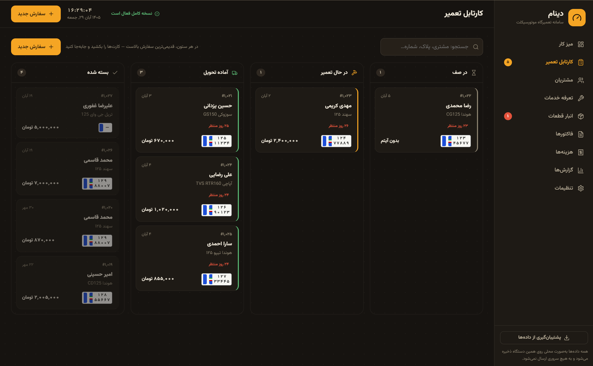
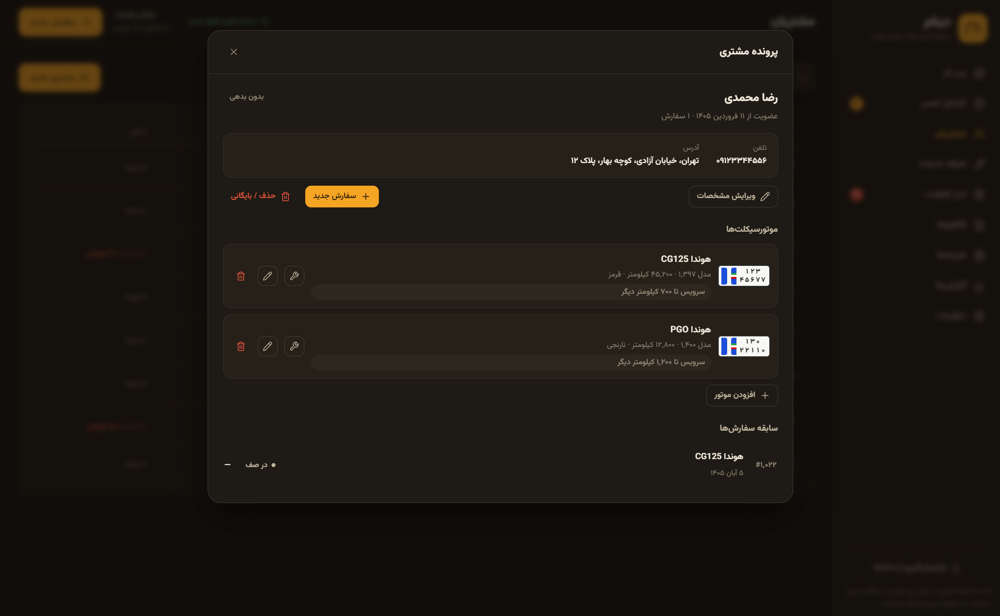
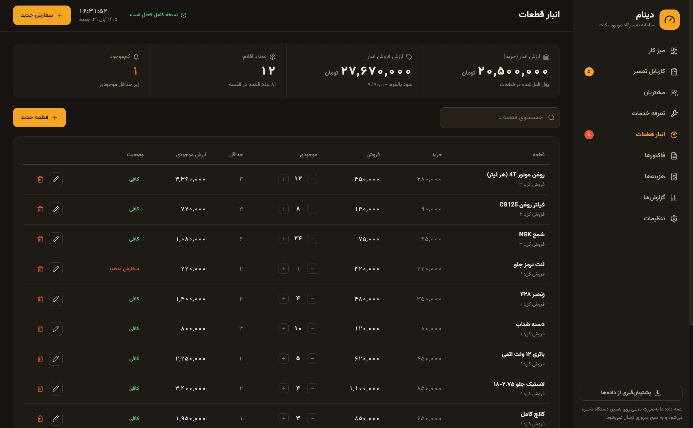
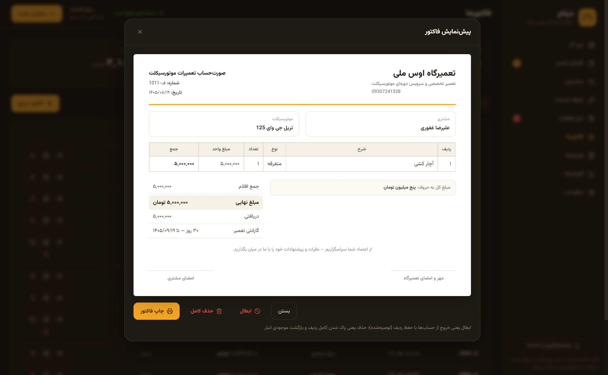
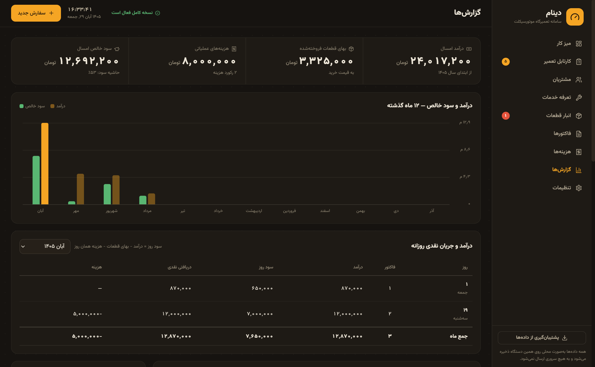
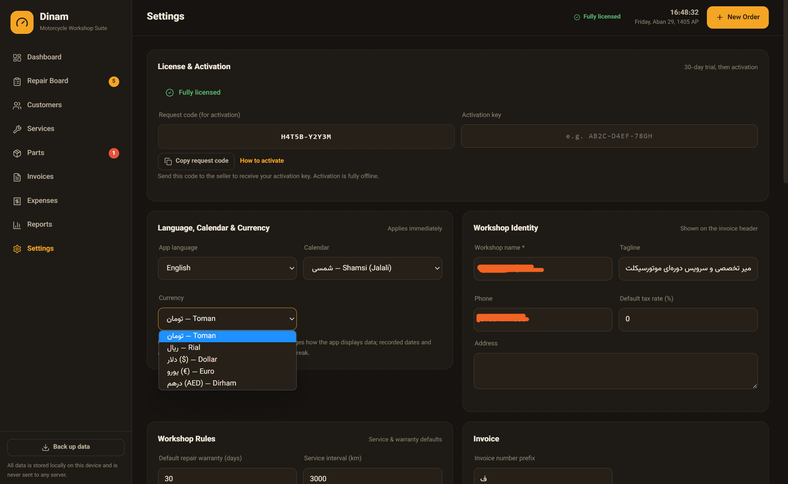

# Dinam — Motorcycle Workshop Management & Accounting

**Dinam** is a workshop-focused management and accounting application shaped around the real workflow of motorcycle repair businesses.

The goal is simple: help a repair shop keep customer and motorcycle records, organize repair jobs, track parts and expenses, issue invoices, and review its business activity in one practical tool.

## Project overview

- **Platforms:** Windows and Android
- **Operating mode:** Designed for offline use
- **Project stage:** Working application, currently used and tested in a motorcycle workshop
- **Trial:** 30-day trial version
- **Product focus:** Motorcycle repair shop operations, service records, inventory, invoicing, and financial visibility

## Main capabilities

- **Repair work management:** organize repair jobs and follow their progress.
- **Customer records:** keep customer information in an organized record.
- **Motorcycle records:** associate motorcycles and their service history with customers.
- **Parts and services:** manage workshop parts and service items.
- **Expense tracking:** record business and workshop expenses.
- **Invoicing:** prepare invoices with options for printing, PDF output, and sharing through WhatsApp.
- **Financial reports:** review financial activity with a 12-month chart.
- **Service reminders:** help track upcoming maintenance and follow-up.
- **Backups:** support daily data backup.
- **Language settings:** change the application language to your preferred language.
- **Regional settings:** configure the financial currency unit and choose the calendar system used to display dates.

## My role

I lead the product work and guide its AI-assisted development. My responsibilities include:

1. Observing workshop operations and identifying practical problems.
2. Gathering requirements from real workshop use.
3. Defining features, workflows, and expected behavior.
4. Translating requirements into clear instructions for AI development tools.
5. Reviewing the generated implementation and testing features in practice.
6. Reporting issues, refining requirements, and prioritizing improvements.

**Important:** My role is product ideation, requirements analysis, workflow design, AI direction, testing, and product iteration. I do not present this project as independently hand-coded software.

## Screenshots

Add clean screenshots to `screenshots/` and update the image links below. Hide customer names, phone numbers, license plates, financial details, and any other private information before uploading.

| Screen | Preview |
|---|---|
| Dashboard |  |
| Repair work orders |  |
| Customer and motorcycle records |  |
| Inventory |  |
| Invoice |  |
| Financial reports |  |
| Settings |  |

## Download

The current installer will be published in the GitHub **Releases** section. Each release should identify the platform, version, release date, system requirements, and trial details.

The trial period is 30 days. Download only from the official Releases page and review the release notes before installation.

## Installation

Installation steps and supported Windows/Android versions will be documented here after the current installer files and exact requirements are confirmed.

## Real-world validation

Dinam is a working application being used and tested in a motorcycle repair workshop, with ongoing testing and refinement.

## Repository scope

This repository contains public project documentation, screenshots, and approved distribution files. It does **not** include private source code, customer records, workshop-sensitive information, or credentials.

---

Dinam is being developed to make everyday workshop management more organized, traceable, and practical.
